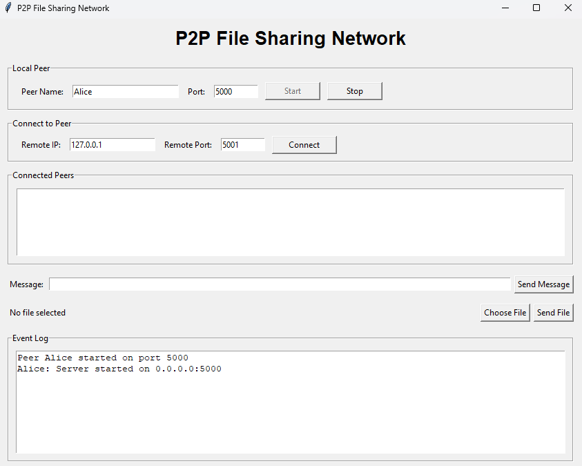
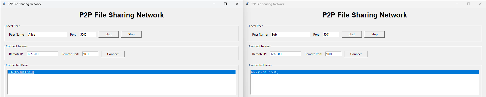
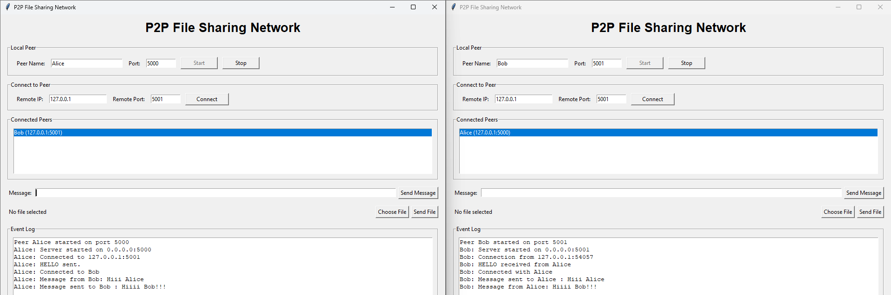
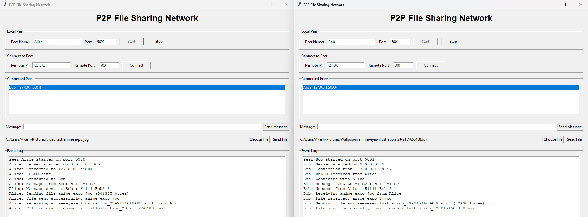
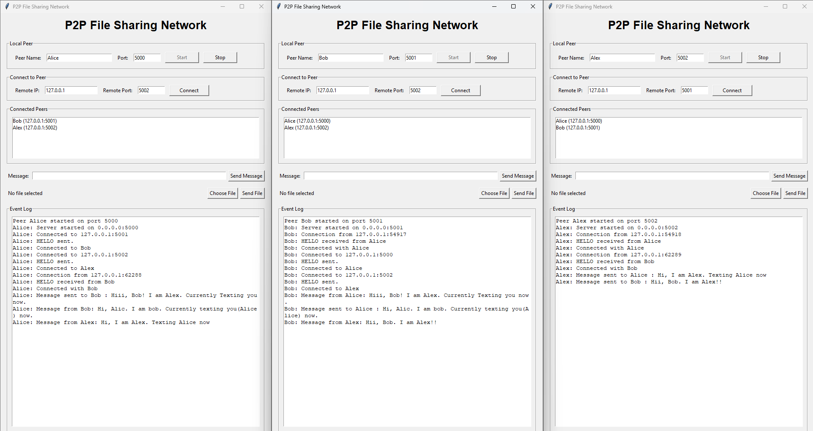

# Peer-to-Peer Network: Communication and File Sharing

## 1. Project Description

This project is a lightweight Peer-to-Peer (P2P) communication and file-sharing application developed in Python for the CSE 433 Blockchain & Distributed Security Lab assignment.

Each running application represents one peer and can work as both a TCP server and a TCP client. Peers connect directly using an IP address and port number without using a central server.

The application supports:

- Direct peer-to-peer TCP connections
- Peer identification using a unique peer ID, peer name, and port
- HELLO / HELLO_ACK handshake
- Text messaging between connected peers
- Binary file transfer
- Multiple connected peers
- Received-file storage in a `downloads/` folder
- File transfer for text files, images, audio, video, PDF, ZIP, and other ordinary files

### Project Architecture

```text
User Interface
      |
      v
   P2P Node
      |
      v
  TCP Socket
      |
      v
 Other Peer
```

Each peer contains both:

```text
TCP Server + TCP Client
```

---

## 2. Requirements

- Python 3.9 or later
- VS Code, PyCharm, or another Python-compatible editor
- Built-in Python `socket` library
- Built-in Python `threading` library
- Tkinter for the graphical interface
---

## 3. Installation / Setup Instructions

### Step 1: Install Python

Install Python 3.9 or a newer version.

Check the installation:

```bash
python --version
```

### Step 2: Organize the files in a structured manner 

Place the project files in one folder. Like this:

```text
P2P_Network/
│
├── main.py
├── p2p_node.py
├── protocol.py
├── requirements.txt
├── README.md
└── downloads/
```

The `downloads/` folder is used to store files received from other peers.

### Step 3: Install Dependencies

No external packages are required. Python's built-in libraries are used.
### Step 4: Check Tkinter

Run:

```bash
python -m tkinter
```

If a Tkinter window opens, the GUI environment is ready.

---

## 4. How to Run the Application

Start a peer by running:

```bash
python main.py
```

The GUI allows the user to enter:

- Peer Name
- Listening Port
- Remote IP address
- Remote Port

The peer can then be started and connected to other peers.

### Example

Peer A:

```text
Name: Alice
Port: 5000
```

Peer B:

```text
Name: Bob
Port: 5001
```

For testing on the same computer, Bob can connect to:

```text
IP: 127.0.0.1
Port: 5000
```

---

## 5. How to Connect Two Peers

### Peer A

1. Run the application.
2. Enter a peer name, for example `Alice`.
3. Enter a listening port, for example `5000`.
4. Click **Start**.

### Peer B

1. Run another instance of the application.
2. Enter a peer name, for example `Bob`.
3. Enter a different listening port, for example `5001`.
4. Click **Start**.
5. Enter Peer A's IP address.
6. Enter Peer A's port.
7. Click **Connect**.

For local testing:

```text
Remote IP:   127.0.0.1
Remote Port: 5000
```

After connection, the peers perform a HELLO / HELLO_ACK handshake and the connected peer appears in the peer list.

### LAN Testing

When using two different computers on the same network, use the actual LAN IP address of the computer running the target peer.

Example:

```text
Computer A:
IP: 192.168.1.10
Port: 5000

Computer B:
IP: 192.168.1.11
Port: 5001
```

Computer B connects to:

```text
192.168.1.10:5000
```

---

## 6. How to Transfer Files

### Send a Text Message

1. Select a connected peer from the peer list.
2. Enter a message.
3. Click **Send Message**.

Example:

```text
Hello Alice!
```

### Send a File

1. Connect to the target peer.
2. Select the target peer from the connected peer list.
3. Click **Choose File**.
4. Select the file.
5. Click **Send File**.

The system supports ordinary binary files, including:

```text
.txt
.jpg / .jpeg / .png
.mp3 / .wav
.mp4 / .avi / .mkv
.pdf
.zip
.docx
```

The application does not need a separate transfer method for each file type. Files are treated as binary data.

### File Transfer Process

The sender first sends file metadata:

```json
{
    "type": "file",
    "filename": "photo.jpg",
    "filesize": 2456789
}
```

The sender then sends the raw file bytes in chunks.

The receiver reads the specified number of bytes and saves the file in:

```text
downloads/
```

For example:

```text
downloads/photo.jpg
```

---

## 7. Example Screenshots

Add screenshots of the working application in this section before submission.

### Screenshot 1 — Peer Startup

_The GUI with the peer name and port entered and the peer started._




### Screenshot 2 — Two Peers Connected

_The connected peer list after one peer connects to another._



### Screenshot 3 — Text Messaging

_A text message being sent and received._



### Screenshot 4 — Image / Video File Transfer

_The file selection, transfering and receiving file._



### Screenshot 5 — Multiple Peers

_Show three peers connected and communicating._



---

## 8. Run Command

The complete project is runnable with:

```bash
python main.py
```
